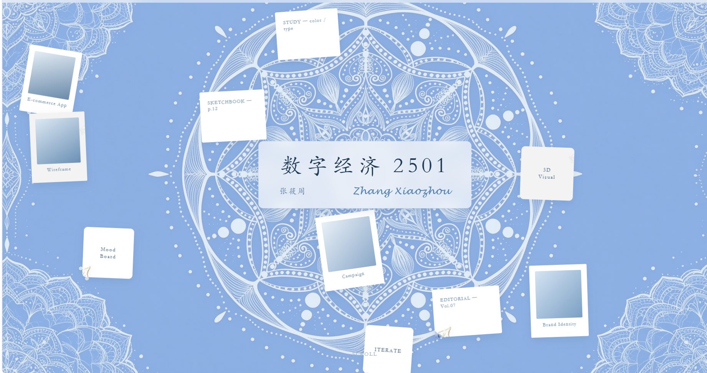

# 蓝白青花风悬浮卡片个人作品集

> 纯原生 HTML/CSS/JS 实现的悬浮动效作品集首页，无任何第三方依赖，克隆后双击即可打开运行。

## ✨ 效果预览

### 首页动效


### 作品详情页


### 交互演示
<video src="video-show.mp4" controls width="100%"></video>

## 🎯 功能特点
- **物理悬浮动效**：首页卡片随机漂浮，鼠标靠近页面中心时，卡片自动聚拢成环形排布，带弹簧物理回弹动画
- **青花视觉风格**：蓝白曼陀罗背景 + 青花瓷边框卡片 + 楷体文字，整体雅致柔和
- **毛玻璃质感**：导航、标题、内容块均使用 backdrop-filter 磨砂效果，通透有层次
- **子页面四段式结构**：固定导航 → 作品标题区 → 作品展示区 → 说明区，从上到下阅读清晰
- **完全离线可用**：无 CDN、无外部字体加载、无框架依赖，断网打开也正常运行
- **响应式适配**：移动端自动调整卡片排布和内容宽度，小屏也有良好体验

## 🚀 使用方式
1. 克隆仓库到本地：
```bash
git clone https://github.com/你的用户名/你的仓库名.git
```
2. 直接双击打开 `index.html` 即可访问，无需启动服务、无需构建。

## 🛠️ 技术栈
- 原生 HTML5 + CSS3 + 原生 JavaScript
- 半隐式欧拉弹簧物理动画（约 60fps 流畅运行）
- CSS `backdrop-filter` 毛玻璃效果
- 系统本地字体栈（楷体优先，无需加载外部字体文件）

## 📁 文件结构
```
.
├── index.html          # 首页（悬浮动效主页面）
├── work-1~5.html       # 5个作品详情页
├── process-1~5.html    # 5个创作过程详情页
├── bg-mandala.jpg      # 全局曼陀罗背景图
├── card-1~4.png        # 青花卡片边框素材
├── screenshot-*.png    # README 预览截图
└── video-show.mp4      # 交互演示视频
```

## 📝 说明
本项目为个人作品集模板，所有案例展示内容已获得相关方授权开源，可自由借鉴使用，欢迎 Star。
